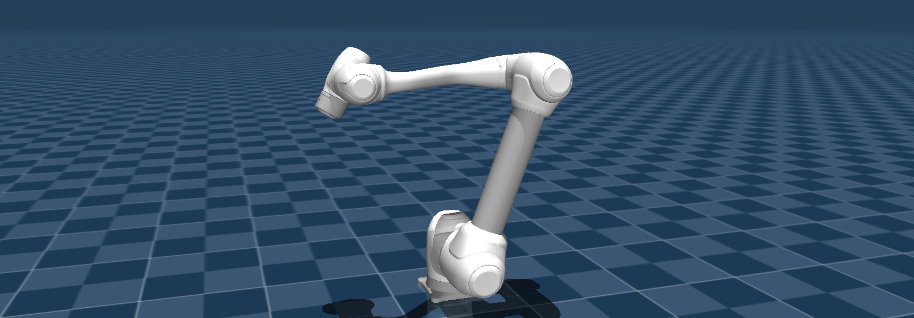
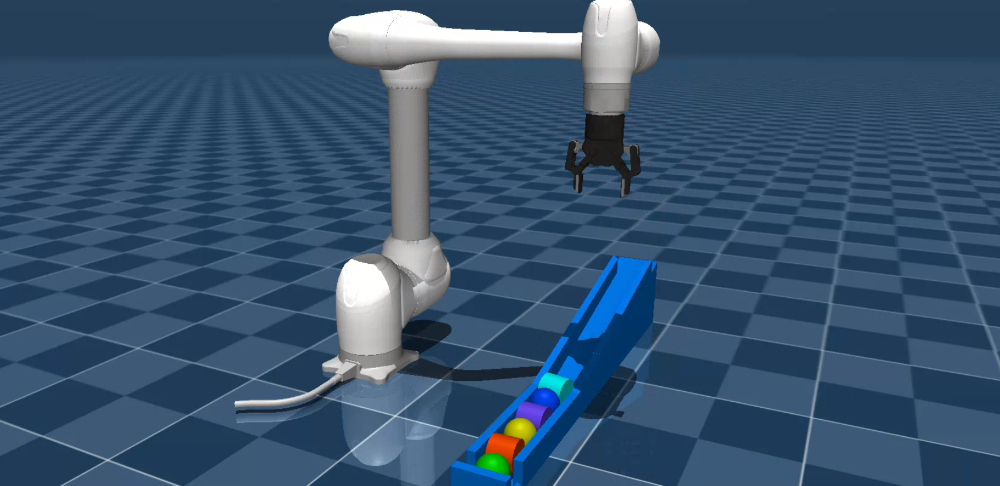

# Use Doosan robots on MuJoCo



## Overview

This package enables controlling Doosan robots in MuJoCo simulation using ROS 2.

Supported models:
- H-SERIES :  **h2515** (blue), **h2017** (blue)
- M-SERIES :  **m1013** (white), **m0609** (white), **m1509** (white), **m0617** (white)
- A-SERIES :  **a0509** (blue), **a0912** (blue)
- E-SERIES :  **e0509** (white)

## Prerequisites

Install the [MuJoCo ROS 2 control](https://github.com/ros-controls/mujoco_ros2_control) plugin. It brings MuJoCo in through `mujoco_vendor`, so no separate MuJoCo download or `MUJOCO_DIR` setting is needed.

```bash
sudo apt update
sudo apt install ros-jazzy-mujoco-ros2-control
```

Alternatively, install it together with the other workspace dependencies through rosdep:

```bash
cd ~/ros2_ws
rosdep install --from-paths src --ignore-src -y
```

`dsr_bringup2_mujoco.launch.py` includes the launch file of this package, so `dsr_mujoco` must be built or installed as well. `dsr_bringup2` does not depend on it, so users who never run MuJoCo do not pull in the simulator.

The joints are driven by position PIDs whose gains are in `dsr_description2/mujoco_models/<model>/pids.yaml`.

## Launch with MuJoCo
- **Launch m1013 in blank scene:**  
   ```bash
   ros2 launch dsr_bringup2 dsr_bringup2_mujoco.launch.py
   ```
- **Launch without the MuJoCo viewer window:**  
   ```bash
   ros2 launch dsr_bringup2 dsr_bringup2_mujoco.launch.py headless:=true
   ```

## Demo example
- **Launch m1013 with gripper in a demo scene:**
   ```bash
   ros2 launch dsr_bringup2 dsr_bringup2_mujoco.launch.py model:=m1013 gripper:=2f85 scene_path:=demo/slope_demo_scene.xml
   ```
- **In another terminal, run Pick & Place movements:**    
   ```bash
   ros2 run dsr_example slope_demo
   ```

### Demo Video
[](https://youtu.be/Jqaam6x79t4)

## [Usage documentation](doc/doc.md)
